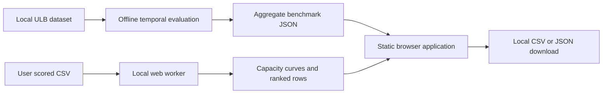

# Architecture

Clearcut separates model experiments from policy decisions. Runtime needs static files and a browser, while Python is used only to reproduce historical evidence.

`src/core.js` owns strict CSV validation, stable ranking, top-k counts, Wilson intervals, capacity profiles and formula-safe export. `src/worker.js` runs parsing and profiling off the UI thread. `src/main.js` owns presentation, routing and volatile tab state. Hash routes work under a static project subpath; relative built asset URLs support a downloaded static build and GitHub Pages.

`evaluation/config.json` pins ranker configuration and seeds. `evaluation/run.py` fits preprocessors only on training data, selects a candidate on validation AP, audits duplicate feature overlap and writes reproducible aggregate statistics to `public/benchmark.json` and `reports/benchmark.json`. No raw transaction rows or models are shipped to browsers. Static hosting serves these checked-in aggregates without running Python.

## Decisions

**Static JavaScript + Vite over a server-rendered React app:** the main operation is local sorting and labeled evaluation, not remote inference. A server would add an upload boundary, account dependency, recurring resource limits and an idle-start problem without improving that operation. Native HTML controls, an accessible SVG curve and a web worker provide the necessary interaction with a small runtime bundle; build tooling is pinned by the lockfile.

**No hosted scoring API:** the original PCA inputs are not merchant-friendly features. Pretending they form a usable live integration would misrepresent the available data. Existing risk systems can export scores; Clearcut evaluates their batch policy without acquiring payment permissions.

**Top-k rather than a universal threshold:** capacity is a hard constraint and arbitrary scores are not probabilities. Top-k guarantees the requested historical review count; a streaming threshold cannot guarantee the same volume under drift. Output is an analysis artifact, never an automated payment instruction.

## Guardrails

- CSV size ≤12 MiB and ≤100,000 rows. Reject an entire malformed batch; never silently omit bad rows.
- Finite score, nonnegative amount, unique identifiers, labels either absent or complete binary values. Higher scores always mean more suspicious.
- Stable file-order tie-break; labels cannot influence ranking. Missing labels keep outcomes unknown; no-positive batches have undefined recall.
- Render user values through HTML escaping and export identifiers with spreadsheet formula protection. Unknown columns are not exported.
- No persistence, analytics, account, external font requests, upload endpoint or runtime model. Closing/reloading clears imported data.
- Dependency lockfile, local commit-message hook, attribution scan and signature-based secret scan. These scans are guardrails, not proof that all possible secret formats are absent.

## Resource exhaustion

The current loaded page can calculate without network. A fresh load needs the static host, and there is no service-worker offline cache or guaranteed reload offline. Slow imports expose a local-processing status; a worker failure gives a reload path. The benchmark fetch has an explicit recovery screen. Rate limiting at the static host returns the host's error and requires retry; no hidden paid fallback exists.

The legacy `backend/`, `dashboard/` and `ml/` remain available for research and historical comparison. Their documentation is not a claim that those services are deployed. The production app calls none of their endpoints.
